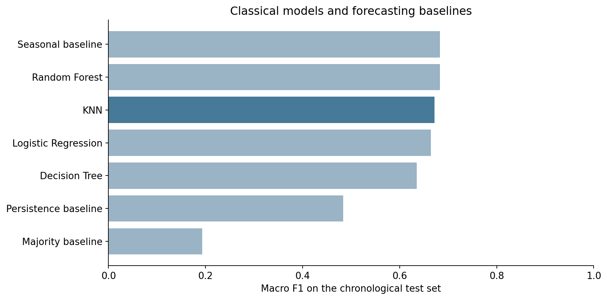
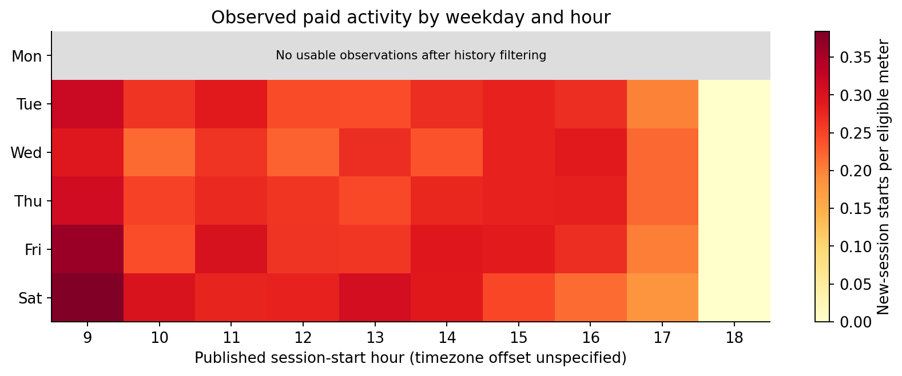

# Forecasting San Francisco Parking Meter Payment Activity

DATA 245 group project by **Jietian Chen, Eric Zhao, Alaa Ahmed, Tramy Nguyen**.

This project forecasts the next hour's **new paid-session activity** in sampled San Francisco street blockfaces using Logistic Regression, KNN, Decision Tree, and Random Forest. It compares the models against majority, persistence, and seasonal historical baselines using a chronological holdout.

The original proposal discussed parking availability. Payment transactions do not supply occupancy ground truth, so the implemented task explicitly measures **payment activity as a limited parking-demand proxy**. High turnover can create many payments even when spaces are available. These predictions must not be presented as vacant-space counts or validated occupancy estimates.

## Quick start

Python 3.11–3.13 is recommended. The completed experiment used Python 3.13.9, pandas 2.3.3, NumPy 2.3.5, and scikit-learn 1.7.2. Install the exact package versions in `requirements-lock.txt` to reproduce the saved model.

```bash
git clone https://github.com/MaisuC/data245-sf-parking-activity.git
cd data245-sf-parking-activity
python -m venv .venv
source .venv/bin/activate
python -m pip install -r requirements-lock.txt

# Fast demonstration using a saved model and real held-out features
python src/predict.py

# Rerun the complete experiment using the included public-data aggregates
python src/train.py

# Verify temporal provenance, target thresholds, and saved predictions
python -m unittest discover -s tests -v

# Open the explanatory notebook
jupyter notebook notebooks/parking_activity.ipynb
```

On Windows, activate with `.venv\Scripts\activate`. Retraining is not required for the quick demo. Only load trusted joblib/pickle files.

The notebook reuses completed outputs by default; set `RUN_TRAINING = True` to regenerate them. `notebooks/parking_activity.py` is the matching exported Python file. The full training implementation is `src/train.py`.

## Data and provenance

- [SFMTA detailed meter revenue transactions](https://data.sfgov.org/d/imvp-dq3v), queried through the public Socrata API.
- [San Francisco parking meter inventory](https://data.sfgov.org/d/8vzz-qzz9), joined using `post_id`.
- Period: September 1–October 31, 2026. Inventory snapshot: November 7, 2026.
- Inventory-only seed-245 sampling selects 16 blockfaces from different neighborhoods, with 233 active M/T, on-street, SFMTA, Grey, single-space meters. Each eligible blockface has 12–35 such meters.
- The source queries returned 27,579 events: 21,665 NS (new session) and 5,914 AT (additional time). AT events do not enter the target count.
- Twelve sampled blockfaces contribute usable modeling observations. Four sampled blockfaces have no events. Coverage varies substantially; see `results/block_coverage.csv`.
- No synthetic training or test observations are used. Unrecorded hours within covered block-days receive zero events; entirely silent block-days receive missing status. This cannot distinguish free parking from an outage.

`data/raw/download_manifest.json` records exact API query URLs, parameters, retrieval time, and counts. Public aggregate observations and the selected meter inventory are included. The 37 MB full-city inventory and query caches are excluded from Git. Source datasets remain subject to their published city terms; this repository does not relicense them.

To repeat the public-data download:

```bash
python src/download_data.py --start 2026-09-01 --end 2026-11-01 --blocks 16
```

The API and inventory can change. Committed observations preserve this experiment; a later download can produce different samples/results. Published session timestamps have no offset, so the pipeline retains them without claiming verified local-time alignment.

## Target and forecast origin

At the beginning of target hour H, the model forecasts activity during [H, H+1):

`activity intensity = NS starts in target hour H / eligible single-space meters in the inventory snapshot`

Training-only tercile boundaries define Low, Medium and High payment activity. The resulting intensity can exceed 1 and is not an occupancy probability. Original boundaries are approximately 0.1053 and 0.3333 starts per meter per hour. Ties mean classes need not be exactly balanced.

Known inputs include target-hour calendar features, blockface identity, latitude, longitude, and snapshot supply. Payment inputs are lagged 1, 2, 24 and 168 hours plus a trailing three-hour mean ending at H−1. The target-hour payment count, target intensity, and target class never enter the feature matrix.

The analytical window is published hours 09:00–18:59, Monday–Saturday. These are standardized study hours, not verified location-specific charging schedules. Missing history and target rows are excluded. Final data contain **4,670 blockface-hour observations** from 40 observed dates.

## Evaluation protocol

1. Split unique target dates approximately 60/20/20: 2,820 training observations (September 8–October 9), 930 validation observations (October 10–21), and 920 test observations (October 22–31). Coverage filtering removes some dates.
2. Calculate class boundaries using training target values only. Fit the scaler and one-hot encoder inside each training pipeline.
3. Evaluate three configurations per algorithm on validation macro F1. Select each algorithm's configuration, then select the ML algorithm using validation only.
4. Refit the selected configurations on training + validation and evaluate on the future test partition. A saved pipeline supports a fast demo.
5. Compare with majority, last-hour persistence, and blockface/weekday/hour historical-mean baselines. The latter uses training + validation averages only.
6. Report accuracy, balanced accuracy, macro precision/recall/F1, weighted F1, MCC, quadratic weighted kappa, high-activity recall, and, for probabilistic ML models, log loss and multiclass one-vs-rest ROC AUC.

Ablation, feature permutation, per-location/hour errors, paired-day bootstrap, and an auxiliary shuffled-split experiment are descriptive post-selection analyses. They do not select a new model from the test scores. Shuffled and chronological test sets contain different observations, so their difference cannot isolate leakage.

## Main result

| Model | Test accuracy | Test macro F1 |
| --- | ---: | ---: |
| Seasonal baseline | 0.6783 | 0.6835 |
| Random Forest | 0.6826 | 0.6832 |
| KNN | 0.6696 | 0.6719 |
| Logistic Regression | 0.6620 | 0.6643 |
| Decision Tree | 0.6359 | 0.6353 |
| Persistence baseline | 0.4848 | 0.4837 |
| Majority baseline | 0.4087 | 0.1934 |

**KNN is the validation-selected ML model**, with validation macro F1 of 0.6563. The seasonal baseline has the highest test macro F1. Random Forest's slightly higher accuracy does not make it the winner on the prespecified primary metric. This experiment does not show that ML improves on the seasonal baseline.

For KNN, calendar/location features achieve test macro F1 0.6344. Adding historical activity increases it to 0.6719. Adding fixed supply to blockface identity gives no observed improvement in that ablation. These comparisons describe the sample and do not establish causal effects.





## Limitations and next steps

- Payment starts reflect payment behavior and turnover, not directly occupied spaces. Ground-truth availability prediction would need sensor labels or an independently validated reconstruction.
- Inventory comes after the transaction period. Historic meter status, supply changes and charging schedules are not independently verified.
- Entirely silent block-days are excluded retrospectively. Sparse reporting, partial outages and this selection rule can bias the sample. Four sampled blockfaces contribute no usable data.
- No Monday rows survive: the required 24-hour history is missing after completely silent Sundays. The final usable sample covers Tuesday–Saturday, so this fitted experiment does not validate Monday forecasts.
- The final holdout covers only eight observed dates. The paired-day bootstrap is descriptive, and neighboring dates may remain dependent.
- This is an evaluation of already sampled blockfaces. It does not establish generalization to unseen neighborhoods or the entire city.
- Each forecast assumes immediately available preceding-hour aggregates. API ingestion delay has not been measured. This is rolling one-hour forecasting, not a multi-hour open-loop forecast or a deployed live service.
- Permutation importance is descriptive and correlated predictors can share importance. No causal feature-effect interpretation is claimed.
- No measured emissions, congestion, or cruising reduction is claimed. Potential relevance to SDG 11/13 requires validation beyond this experiment.

## Repository contents

| Path | Purpose |
| --- | --- |
| `src/download_data.py` | Reproducible inventory selection and public API aggregation |
| `src/train.py` | Cleaning, labels, chronology, tuning, baselines, metrics, ablation and figures |
| `src/predict.py` | Quick saved-model demonstration |
| `notebooks/parking_activity.ipynb` | Executable walkthrough with actual results |
| `notebooks/parking_activity.py` | Corresponding notebook Python export |
| `models/` | Saved model and actual held-out input example |
| `data/raw/` | Public aggregates, selected inventory, metadata, query manifest |
| `data/processed/` | Final modeling data and complete hourly panel |
| `results/` | Machine-readable metrics, predictions, provenance and figures |
| `tests/` | Checks for chronology, historical inputs, thresholds and saved-model consistency |
| `docs/TEAM_REVIEW.md` | Proposed review division and truthful contribution disclosure |

## Transparency

OpenAI Codex assisted with code, API queries, experiment execution, analysis scaffolding, notebook/documentation generation and repository setup. Individual human contributions require confirmation. No earlier scrum process, pair programming, competition rank, publication result, deployment, or completed team review is claimed. See `docs/TEAM_REVIEW.md`.

The repository was created on November 20, 2026. Its commit history records work from that point forward. Presentation slides and the final IEEE-format report are separate pending deliverables.
